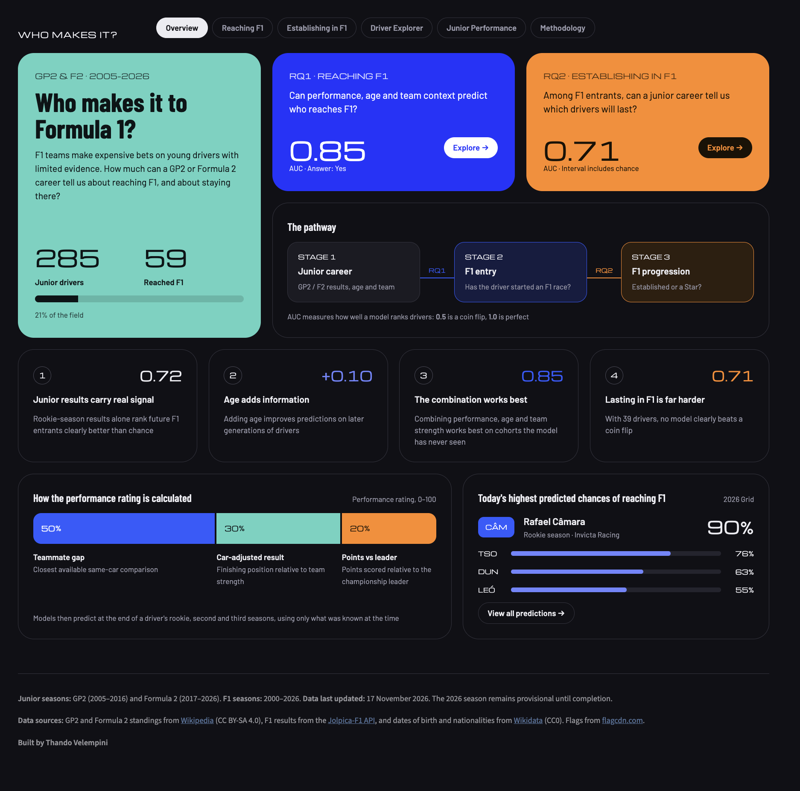
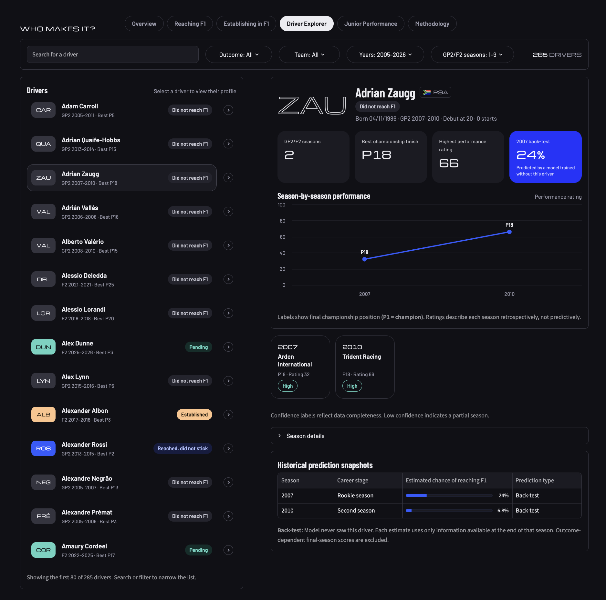
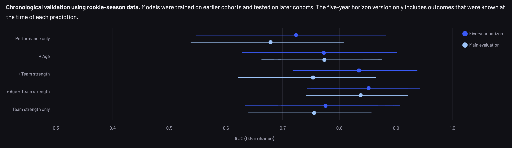

# Who Makes It to Formula 1?

Can a driver's junior career tell you whether they will reach Formula 1, and whether they will last once they get there?

F1 teams make expensive bets on young drivers with very little evidence. This project asks how much of that evidence is actually useful, using every GP2 and FIA Formula 2 season from 2005 to 2026 (285 drivers, 59 of whom reached F1).

It is built as a scouting question, not a prediction contest: the emphasis is on what could genuinely have been known at the time a decision was made.

**Live app:** https://f1-talent-pipeline.streamlit.app/



---

## Key Findings

**1. Reaching F1 can be forecast from a driver's rookie F2 season**

Using only information available at the end of their rookie season, a model combining performance, age and team context predicted which drivers would reach F1 with an **AUC of 0.85 (95% CI 0.74–0.94)** on later cohorts it had never seen. Results alone reach about 0.72; how young a driver is and which team they drive for add roughly as much information again.



**2. Nothing in junior results reliably predicted who would establish themselves in F1**

Among drivers who reached F1, rookie-season performance separated those who lasted from those who did not no better than a coin flip (AUC of 0.51). Younger drivers leaned towards success, but with only 39 drivers, no result was conclusive.

**3. The longer a driver stays in F2, the less their results explain promotion**

Predictive power drops from 0.72 after one season to 0.60 after three, at which point the team a driver races for says more than how they perform.

**4. A dominant late-career F2 season is a weak signal**

The highest-rated junior seasons in the dataset belong mostly to drivers in their third or fourth year: Pantano (2008), Razia (2012), Leimer (2013), de Vries (2019) and Drugovich (2022). None went on to establish themselves in F1: only de Vries reached F1 afterwards, and his career there lasted under two seasons.

*AUC measures how well a model ranks drivers: 0.5 is a coin flip, 1.0 is perfect.*

---

## Research Questions

| | Question | Population | Outcome |
|---|---|---|---|
| **RQ1: Progression** | Can performance, age and competitive context predict whether a driver will eventually reach F1? | GP2/F2 drivers not yet in F1 | Started at least one F1 race |
| **RQ2: Establishment** | Among F1 entrants, can junior-career characteristics distinguish those who establish themselves? | Drivers who reached F1 with a settled career | Established or Star |

RQ2 is inherently harder and the sample is small, so the project reports it as an open question rather than forcing an answer.

---

## Data

| Source | Used for |
|---|---|
| Wikipedia season pages (GP2 2005–2016, FIA F2 2017–2026) | Final standings, points, teams and rounds entered |
| [Jolpica-F1 API](https://github.com/jolpica/jolpica-f1) (successor to Ergast) | F1 standings and race-by-race results (2000–2026) |
| Wikidata | Dates of birth and nationality |

Drivers are matched across sources by their Wikipedia article, with redirects resolved, so name variants (e.g. Hulkenberg / Hülkenberg, Zhou Guanyu / Guanyu Zhou) become one person. A suite of 19 data-quality checks (`src/data_checks.sql`) covers identity matching, team mapping, standings consistency, career anomalies and a manual random sample.

### Outcome Tiers

| Tier | Rule | Drivers |
|---|---|---|
| Star | Top-5 F1 championship finish or 3+ race wins | 8 |
| Established | 3+ full F1 seasons (started at least half the races) | 15 |
| Reached, did not stick | F1 starts, fewer than 3 full seasons | 23 |
| Did not reach F1 | No F1 starts, no outstanding opportunity | 191 |
| Too early to tell | Raced in F1 as of 2026, with fewer than 3 full seasons | 6 |
| Pending | No F1 starts yet, raced in GP2/F2 in 2025–2026 | 34 |
| Excluded | Raced in F1 before GP2/F2 (different pathway), or career ended by circumstances unrelated to performance | 8 |

---

## Method

### Driver Performance Rating

Each junior season gets a rating built from three components:

- **Teammate gap (50%):** Points beyond the other seat in the same car, as a share of the leader's points. Teammates drive identical machinery, so this is the most car-neutral measure.
- **Car-adjusted result (30%):** Finishing position compared with what the team's strength would predict, using a regression fitted in SQL.
- **Points vs leader (20%):** Raw output, comparable across the series' different scoring systems.

### Leakage-safe experiments

Early versions of this analysis produced flattering results that did not survive scrutiny. The final design addresses each problem found:

| Problem | Fix |
|---|---|
| Ratings were scaled using all seasons, including future ones | **Time-safe ratings:** Each season is rated only with data up to that season (3-season burn-in, so ratings start in 2007) |
| A "final season" snapshot was chosen using the outcome itself (the season before an F1 debut vs. the end of a failed career) | **At-risk snapshots:** Predictions at the end of a driver's 1st, 2nd and 3rd seasons, for drivers not yet in F1 |
| Random cross-validation does not show whether patterns hold for new generations | **Chronological validation:** Train on earlier rookie cohorts, predict each later one |
| Training labels could include outcomes not yet known at the prediction date | **Strict 5-year horizon:** Outcome = reached F1 within 5 years, and a cohort is only used for training once that window has closed |
| Intervals ignored model-fitting uncertainty | **Full-pipeline out-of-bag bootstrap:** Resampling drivers and refitting everything, with failed replicates reported |

Each feature set is compared with performance alone on the same resamples, so "age helps" means the improvement's interval excludes zero, not just that the number went up.

### What was tested and rejected

- **Composite "potential" ratings.** Two versions (performance against same-age peers; current rating plus age-typical development) added nothing once leakage was removed. An apparent gain in the development version disappeared when its curve was fitted without seeing the drivers it was scoring. Age on its own carried all the signal they had.
- **The outcome-dependent final-season snapshot.** It scored 0.87, but the snapshot itself was selected using the outcome. It is kept as exploratory only.

---

## Results

### RQ1: Progression (rookie season)

| Validation | Performance alone | + age + team strength | Gain |
|---|---|---|---|
| Cross-validation (206 drivers, 45 reached F1) | 0.72 (0.59–0.86) | **0.83** (0.74–0.91) | +0.10, not conclusive |
| Chronological, eventual outcome (140 test drivers) | 0.68 (0.54–0.81) | **0.84** (0.74–0.92) | **+0.16** (+0.08 to +0.25) |
| Chronological, strict 5-year horizon (107 test drivers) | 0.72 (0.55–0.88) | **0.85** (0.74–0.94) | **+0.13** (+0.03 to +0.23) |

Three independent validation designs agree on about 0.83–0.85.

### RQ1 by stage

| Prediction point | Drivers | Reached F1 | Performance | Best model |
|---|---|---|---|---|
| End of season 1 | 206 | 45 | 0.72 | 0.83 (+ age + team strength) |
| End of season 2 | 138 | 37 | 0.72 | 0.78 (+ age + team strength) |
| End of season 3 | 87 | 20 | 0.60 (CI includes chance) | 0.70 (team strength alone) |

Later stages ask a narrower question: *among drivers still in F2, who goes on to F1?* Most future stars were promoted after one season, so they are absent from later rows by design. Full population definitions and class counts are generated in `data/results/risk_population.md`.

### RQ2: Establishment

| Prediction point | Drivers | Established/Star | Performance | Best model |
|---|---|---|---|---|
| End of season 1 | 39 | 19 | 0.51 (0.17–0.78) | 0.71 (0.43–0.93) |
| End of season 2 | 33 | 13 | 0.52 | 0.65 |

No interval excludes chance.

### Interpreting team strength

A driver's F2 team carries about as much predictive information as their results (AUC 0.74 vs 0.72 for results alone). That does not mean a fast car gets you to F1: top junior teams recruit drivers already rated as prospects, and academy-backed drivers are placed in top seats. Team strength mixes talent, backing and opportunity, and this data cannot separate them. Notably, it helps predict reaching F1 but not succeeding there.

---

## Limitations

This analysis faces several important constraints, mainly due to data availability, sample size and the complexity of real-world racing careers.

- **Small samples for RQ2.** 39 drivers cannot distinguish a moderate effect from none.
- **Season-level junior data.** Standings and team entries only; no race-by-race results, qualifying pace or tyre data.
- **Mid-season team switches** (about 6% of seasons) are compared against the team with the most rounds; their points include races for both teams.
- **Confounded context.** Team placement reflects talent, funding and academy support together.
- **Bootstrap intervals in the chronological tests** resample test drivers around fixed models, so they are tighter than the full-pipeline intervals. In other words, they repeatedly sample the test drivers while keeping the trained model fixed, rather than re-running the entire modelling process each time.
- **Recent cohorts are incomplete.** Pending drivers are excluded from eventual-outcome analysis.

---

## Running the project

**Requirements:** Python 3.11+, PostgreSQL.

```bash
python3 -m venv .venv && source .venv/bin/activate
pip install requests beautifulsoup4 lxml pandas "psycopg[binary]" scikit-learn
```

Create an empty PostgreSQL database called `f1_talent`, then set your connection details:

```bash
export PGPASSWORD="your_password"          # PGHOST, PGPORT, PGUSER default to localhost, 5432, postgres
export CONTACT_EMAIL="you@example.com"     # sent to Wikipedia/Wikidata as API etiquette
```

Run the pipeline in order:

```bash
python3 src/run_part1.py    # collect data and build the clean tables
python3 src/run_part2.py    # F1 race results and outcome tiers
python3 src/run_part3.py    # Driver Performance Rating
python3 src/run_checks.py   # data-quality checks
python3 src/run_part4.py    # exploratory: potential ratings and original models
python3 src/run_part4b.py   # leakage-safe experiment (the headline results)
```

All downloads are cached in `data/raw/`, so later runs are fast. Results are written to `data/results/`.

### Structure

```
src/
├── run_part1.py / part1_build.sql          data collection and clean tables
├── run_part2.py / part2_outcomes.sql       F1 results and outcome tiers
├── run_part3.py / part3_performance.sql    performance rating
├── run_checks.py / data_checks.sql         data-quality checks
├── run_part4.py / part4_potential.sql      exploratory potential and models
└── run_part4b.py / part4b_experiment.sql   leakage-safe experiment
```

Each part is a Python runner plus one SQL file. Python handles collection and modelling; the cleaning, ratings, outcome definitions and snapshots are written in SQL and run in PostgreSQL.

---

## Credits

- **Junior seasons:** GP2 (2005–2016) and Formula 2 (2017–2026) standings from [Wikipedia](https://en.wikipedia.org) (CC BY-SA 4.0)
- **F1 results:** [Jolpica-F1 API](https://github.com/jolpica/jolpica-f1) (2000–2026)
- **Dates of birth and nationalities:** [Wikidata](https://www.wikidata.org) (CC0)
- **Flags:** [flagcdn.com](https://flagcdn.com)

The 2026 season remains provisional until completion.
